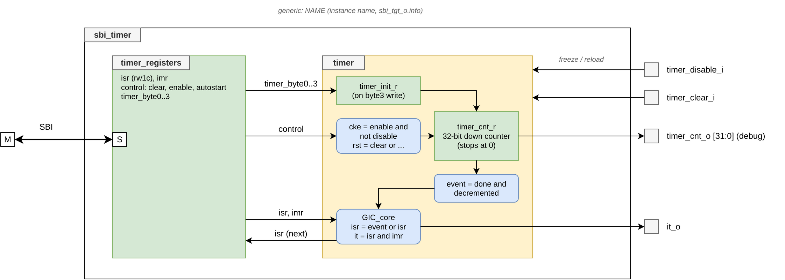
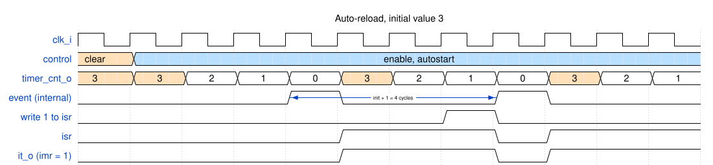

<!--
  README MODEL (common to every Asylum IP, keep the same headings)
  ----------------------------------------------------------------
  Regenerate from the sources, never from the previous README text alone:
    hdl/*.vhd (entities, generics, ports), hdl/csr/*.hjson (register map),
    <IP>.core (VLNV, targets, depends), mk/targets.txt, sim/, syn/, esw/.
  Sections, in this order:
    badges / title + one-line pitch / Overview / Features / Block Diagram /
    Getting Started / Hardware Interfaces / Configuration / Resources /
    Theory of Operation / Registers / Programmer's Guide /
    Design Verification / Dependencies and Related IPs / License
  Rules:
    - English, short and factual: every statement backed by the sources.
    - No VLNV line: the version badge shows it.
    - Badges: first line version, license; second line CI, lint, sim, syn.
    - Block diagram and FSM: pages Overview and FSM of doc/<NAME>.drawio, exported to
      doc/<NAME>-Overview.png and doc/<NAME>-FSM.png (make -C doc).
    - Timing diagrams: WaveDrom source doc/<NAME>-<what>.json, rendered
      doc/<NAME>-<what>.svg (make -C doc), shown as images.
    - No CPU named (OpenBlaze, PicoBlaze, RISC-V) outside the CPU and SoC IPs.
    - Registers: link to the generated hdl/csr/<X>_csr.md, never copy the tables.
    - Tables: Configuration = Name|Type|Default|Description,
      Hardware Interfaces = Name|Direction|Type|Description, grouped by interface.
    - A section with nothing to say is one line ("This IP has no
      software-visible registers."), never removed.
-->
[](https://github.com/deuskane/asylum-component-timer/tags)
[](LICENSE)

[](https://github.com/deuskane/asylum-component-timer/actions/workflows/ci.yml)
[](https://github.com/deuskane/asylum-component-timer/actions/workflows/ci.yml)
[](https://github.com/deuskane/asylum-component-timer/actions/workflows/ci.yml)
[](https://github.com/deuskane/asylum-component-timer/actions/workflows/ci.yml)

# Timer

**A small, readable timer in VHDL: 32-bit down counter, one-shot or auto-reload, interrupt with status and mask registers, seven 8-bit registers.**

Part of the [Asylum project](https://github.com/deuskane/asylum-project), a collection of small IP cores, written to be read and learned from.

## Table of Contents

1. [Overview](#overview)
2. [Features](#features)
3. [Block Diagram](#block-diagram)
4. [Getting Started](#getting-started)
5. [Hardware Interfaces](#hardware-interfaces)
6. [Configuration](#configuration)
7. [Resources](#resources)
8. [Theory of Operation](#theory-of-operation)
9. [Registers](#registers)
10. [Programmer's Guide](#programmers-guide)
11. [Design Verification](#design-verification)
12. [Dependencies and Related IPs](#dependencies-and-related-ips)
13. [License](#license)

## Overview

This IP counts clock cycles for software: a delay, a timeout or a periodic tick. Software writes a 32-bit initial value, starts the count, and gets an interrupt (or polls a status bit) when the counter reaches 0. With auto-reload, the counter starts again from the initial value: one interrupt every `init + 1` clock cycles. Software drives the IP through seven 8-bit registers on the SBI bus (the simple bus of Asylum).

Two inputs let the rest of the system freeze (`timer_disable_i`) or reload (`timer_clear_i`) the counter without software, and the current counter value is on a debug output (`timer_cnt_o`): it is not readable by software.

The sources also hold `timer_v1`, the first version of the IP, with its own direct `cs`/`re`/`we` bus (see [timer_v1](#timer_v1-legacy)). It is not used by `sbi_timer`.

## Features

- 32-bit down counter clocked by `clk_i`, one decrement per cycle, stops at 0
- One-shot or auto-reload (`control.autostart`): with auto-reload, one event every `init + 1` cycles
- 32-bit initial value written as 4 bytes, taken at once on the write of the last byte (`timer_byte3`): a reload never uses a half-written value
- Software reload (`control.clear`, set after reset) and start / stop (`control.enable`)
- Hardware freeze (`timer_disable_i`) and reload (`timer_clear_i`) inputs
- Interrupt event when the counter reaches 0 by counting (a counter held at 0 is not an event), interrupt status register (write 1 to clear, can be polled) and mask register
- Zero wait state bus accesses

## Block Diagram



## Getting Started

The cores of the Asylum IPs are published in the FuseSoC library [asylum-cores](https://github.com/deuskane/asylum-cores) (with the UVVM core used by the testbench):

```bash
pip install fusesoc
fusesoc library add https://github.com/deuskane/asylum-cores
fusesoc run --target sim_timer_autoreload asylum:component:timer  # needs GHDL
```

To use the IP in your design, add `asylum:component:timer` to the `depend` list of your core and instantiate `sbi_timer` (library `asylum`):

```vhdl
library asylum;
use     asylum.sbi_pkg.all;
use     asylum.timer_pkg.all;

  ins_timer : sbi_timer
    generic map
    ( NAME            => "TIMER0"
    )
    port map
    ( clk_i           => clk
     ,arst_b_i        => arst_b
     ,sbi_ini_i       => sbi_ini          -- 3 address bits, 8-bit data
     ,sbi_tgt_o       => sbi_tgt
     ,timer_disable_i => '0'
     ,timer_clear_i   => '0'
     ,timer_cnt_o     => open
     ,it_o            => timer_it
    );
```

[PicoSoC](https://github.com/deuskane/asylum-soc-picosoc) is a complete example: it connects this IP to a CPU and an interrupt controller.

## Hardware Interfaces

Top-level entity: **`sbi_timer`** ([hdl/sbi_timer.vhd](hdl/sbi_timer.vhd)), component in `asylum.timer_pkg`.

### Clock and Reset

| Name | Direction | Type | Description |
|------|-----------|------|-------------|
| `clk_i` | in | std_logic | System clock, the only clock of the IP, also the counting clock |
| `arst_b_i` | in | std_logic | Asynchronous reset, active low |

### Bus (SBI)

| Name | Direction | Type | Description |
|------|-----------|------|-------------|
| `sbi_ini_i` | in | sbi_ini_t | Request from the initiator (`cs`, `re`, `we`, `addr`, `wdata`); 3 address bits, 8-bit data |
| `sbi_tgt_o` | out | sbi_tgt_t | Response to the initiator (`ready`, `rdata`, `info`) |

### Timer control

| Name | Direction | Type | Description |
|------|-----------|------|-------------|
| `timer_disable_i` | in | std_logic | 1: the counter does not decrement (freeze); synchronous to `clk_i` |
| `timer_clear_i` | in | std_logic | 1: the counter is loaded with the initial value (and held while 1); synchronous to `clk_i` |

### Debug

| Name | Direction | Type | Description |
|------|-----------|------|-------------|
| `timer_cnt_o` | out | std_logic_vector(31 downto 0) | Current counter value (not software visible) |

### Interrupt

| Name | Direction | Type | Description |
|------|-----------|------|-------------|
| `it_o` | out | std_logic | `isr and imr`: active high, level, until software clears `isr` or masks it |

<details>
<summary><b>timer</b>: the counter behind the registers</summary>

[hdl/timer_core.vhd](hdl/timer_core.vhd), component in `asylum.timer_pkg`. No generic. Same `clk_i`, `arst_b_i`, `timer_disable_i`, `timer_clear_i`, `timer_cnt_o`, `it_o` as the top level, and the record ports of the register bank generated by regtool:

| Name | Direction | Type | Description |
|------|-----------|------|-------------|
| `sw2hw_i` | in | timer_sw2hw_t | Register values and write strobes (`asylum.timer_csr_pkg`) |
| `hw2sw_o` | out | timer_hw2sw_t | Next value of `isr` |

</details>

<details>
<summary><b>timer_v1</b>: first version of the IP, direct bus</summary>

[hdl/timer_v1.vhd](hdl/timer_v1.vhd), component in `asylum.timer_pkg`.

| Name | Direction | Type | Description |
|------|-----------|------|-------------|
| `clk_i` | in | std_logic | System clock |
| `cke_i` | in | std_logic | Clock enable of the registers |
| `arstn_i` | in | std_logic | Asynchronous reset, active low |
| `cs_i`, `re_i`, `we_i` | in | std_logic | Chip select, read enable (a read of `status` clears the event), write enable |
| `addr_i` | in | std_logic_vector(SIZE_ADDR-1 downto 0) | Address (0: status, 1: control, 4..7: counter bytes) |
| `wdata_i` | in | std_logic_vector(SIZE_DATA-1 downto 0) | Write data |
| `rdata_o` | out | std_logic_vector(SIZE_DATA-1 downto 0) | Read data, combinational on `addr_i` |
| `busy_o` | out | std_logic | Always `'0'` |
| `interrupt_o` | out | std_logic | Always `'0'` (interrupt not implemented) |
| `interrupt_ack_i` | in | std_logic | Not used |

</details>

## Configuration

| Name | Type | Default | Description |
|------|------|---------|-------------|
| `NAME` | string | `""` | Instance name, visible in `sbi_tgt_o.info` |

`sbi_timer` has no other generic: the counter is 32 bits wide, the registers 8 bits wide.

Generics of `timer_v1`: `TICK` (positive, `1000`: clock cycles per tick in tick mode), `SIZE_ADDR` (natural, `3`), `SIZE_DATA` (natural, `8`; 8, 16 or >= 32 handled), `IT_ENABLE` (boolean, `false`, not used).

## Resources

Figures of the `syn_*` targets (`make nonreg_syn`, see [Targets](#targets)): one wrapper per variant, [syn/sbi_timer_wrapper.vhd](syn/sbi_timer_wrapper.vhd) (`syn_timer_default`) and [syn/timer_v1_wrapper.vhd](syn/timer_v1_wrapper.vhd) (`syn_timer_v1_*`), with the generics of each configuration, synthesized by Yosys and its GHDL plugin; the reports are in the build directory of each target.

| Configuration | LUT¹ | LUTRAM¹ | FF¹ | CARRY4¹ | MUXF7/F8¹ | BRAM¹ | DSP¹ | Area² (µm²) | kGE³ |
|---|---|---|---|---|---|---|---|---|---|
| `syn_timer_default` (`sbi_timer`) | 196 | 0 | 103 | 8 | 111 | 0 | 0 | 4386.71 | 1.169 |
| `syn_timer_v1_default` (`timer_v1`, tick 1000) | 119 | 0 | 80 | 11 | 14 | 0 | 0 | 3915.00 | 1.043 |
| `syn_timer_v1_it` (`timer_v1`, tick 10, `IT_ENABLE`) | 117 | 0 | 74 | 9 | 7 | 0 | 0 | 3643.49 | 0.971 |

¹ Xilinx Artix-7 (LUT6), Yosys 0.33 `synth_xilinx -flatten -noiopad -noclkbuf`, before place and route: every cell of the netlist is counted, Vivado may differ. Identical cells are merged as a vendor tool does (`opt_merge -share_all`): the inverters of an active-low reset net become one; every remaining cell is counted, an `INV` as a `LUT1` (32 `INV` in the 196 LUTs of `syn_timer_default`). The IP has no memory: no LUTRAM, no BRAM. Flip-flops of `sbi_timer`: 38 in the register bank (`timer_byte0..3`, `control`, `isr`, `imr`, write strobe of `timer_byte3`), 32 for `timer_init_r`, 32 for the counter (without reset), 1 for the decrement flag.

² SkyWater sky130 `sky130_fd_sc_hd`, typical corner (tt, 25 °C, 1.80 V), Yosys 0.33 `synth` + `dfflibmap` + `abc -liberty`: standard-cell area only, no timing constraint, no buffering, clock tree or placement.

³ Area in thousands of NAND2 gate equivalents (`sky130_fd_sc_hd__nand2_1` = 3.7536 µm²).

## Theory of Operation

### Hierarchy

| File | Unit | Role |
|------|------|------|
| [hdl/sbi_timer.vhd](hdl/sbi_timer.vhd) | `sbi_timer` | Top level: `timer_registers` + `timer` |
| [hdl/timer_core.vhd](hdl/timer_core.vhd) | `timer` | Initial value register, 32-bit counter and its control, event, `GIC_core` |
| [hdl/timer_pkg.vhd](hdl/timer_pkg.vhd) | `timer_pkg` | Components of `sbi_timer`, `timer` and `timer_v1` |
| `hdl/csr/timer_csr.vhd` | `timer_registers` | Register bank, generated by regtool from [hdl/csr/timer.hjson](hdl/csr/timer.hjson) |
| [hdl/timer_v1.vhd](hdl/timer_v1.vhd) | `timer_v1` | First version of the IP, see [timer_v1](#timer_v1-legacy) |

### Initial value

The initial value is `timer_byte3 & timer_byte2 & timer_byte1 & timer_byte0` (`timer_byte0` is the least significant byte). It is copied into `timer_init_r` on the write of `timer_byte3` only: write `timer_byte0..2` first and `timer_byte3` last. The register bank gives the write strobe of `timer_byte3` one cycle after the write, together with the new value; during that cycle the counter logic already uses the new value, so a reload on the next edge takes it (for example a start written right after `timer_byte3`).

### Counter

Every rising edge of `clk_i`, in this order of priority:

1. **reload** (`counter = initial value`) when `control.clear = 1`, or `timer_clear_i = 1`, or `control.autostart = 1` and the counter is 0;
2. **decrement** when `control.enable = 1`, `timer_disable_i = 0` and the counter is not 0;
3. otherwise the counter keeps its value.

- `control.clear` is 1 after reset: the counter follows the initial value until software clears this bit. The counter has no reset of its own: it is loaded on the first clock edge of the reset (the reset value of the initial value is 0).
- One-shot (`autostart = 0`): the counter stops at 0.
- Auto-reload (`autostart = 1`): the counter is reloaded on the edge after it reached 0, so one period is `init + 1` cycles. The reload does not depend on `enable` and `timer_disable_i`: setting `autostart` with the counter at 0 reloads it at once, even when the counter is frozen.
- With an initial value of 0 the counter never decrements, so no event is ever raised.



### Interrupt

- The event is a one-cycle pulse when the counter reaches 0 **by a decrement** (`done and decremented in the previous cycle`). A counter held at 0 (one-shot finished, stopped, reloaded with 0, after reset) is not an event: re-enabling or unmasking the timer in this state raises nothing.
- `GIC_core` of `asylum:system:GIC` sets `isr` on the event (`isr = event or isr`), masked or not: software can poll `isr`. `it_o` is `isr and imr`: `imr` only masks the interrupt output, `it_o` rises on the edge after the counter reached 0.
- Software clears `isr` by writing 1 (`rw1c`); writing 0 has no effect. A write of 1 to `isr` on the very edge that sets `isr` (the cycle after the counter reached 0) clears it: that event is lost. In auto-reload mode, acknowledge the interrupt early in the period.

### timer_v1 (legacy)

Registers: 0 = `status` (bit 0: event, cleared on read), 1 = `control` (bit 0: enable, bit 1: autostart, bit 2: it_enable, bit 3: use_tick), 4..7 = counter bytes (write: initial value, read: current value). In tick mode (`use_tick = 1`) the counter decrements once every `TICK` cycles. The enable bit is cleared at the end of the count unless autostart is set. Its interrupt output is not implemented (`interrupt_o = '0'`). It is synthesized (`syn_timer_v1_*`) but not simulated.

## Registers

Seven 8-bit registers (3 address bits): `isr` (0x0), `imr` (0x1), `control` (0x2), `timer_byte0..3` (0x4..0x7); 0x3 is not used.

- Register documentation: **[hdl/csr/timer_csr.md](hdl/csr/timer_csr.md)**
- C header: [hdl/csr/timer_csr.h](hdl/csr/timer_csr.h)
- Source: [hdl/csr/timer.hjson](hdl/csr/timer.hjson) (regtool)

## Programmer's Guide

### Start a count

1. Write `control = clear` (stopped, the counter follows the initial value).
2. Write `timer_byte0`, `timer_byte1`, `timer_byte2`, then `timer_byte3`.
3. Write 1 to `isr` to drop an old event, then set `imr` if the interrupt is wanted.
4. Write `control = enable` (one-shot) or `enable | autostart` (periodic): the count starts from the initial value, the event comes `init + 1` cycles later.

`control.enable = 0` (with `clear = 0`) pauses the count, `enable = 1` resumes it from the same value.

### Example

The registers are 8 bits wide, at consecutive byte addresses from the base address of the IP (`0x40003000` is an example, use the address map of your SoC).

```c
#include <stdint.h>
#include "timer_csr.h"

#define TIMER_BASE ((uintptr_t)0x40003000u)   // example base address

static inline void reg_wr(uint32_t offset, uint8_t data)
{
  *(volatile uint8_t *)(TIMER_BASE + offset) = data;
}

static inline uint8_t reg_rd(uint32_t offset)
{
  return *(volatile uint8_t *)(TIMER_BASE + offset);
}

// Stop the timer and load the initial value (byte3 last: the 32-bit value
// is taken on its write)
static void timer_load(uint32_t init)
{
  reg_wr(TIMER_CONTROL, 1 << TIMER_CONTROL_CLEAR);  // stopped, counter = initial value
  reg_wr(TIMER_TIMER_BYTE0, (uint8_t)(init      ));
  reg_wr(TIMER_TIMER_BYTE1, (uint8_t)(init >>  8));
  reg_wr(TIMER_TIMER_BYTE2, (uint8_t)(init >> 16));
  reg_wr(TIMER_TIMER_BYTE3, (uint8_t)(init >> 24));
}

// Periodic interrupt, one every period clock cycles (period >= 2)
void timer_start_periodic(uint32_t period)
{
  timer_load(period - 1);                            // one event every init + 1 cycles
  reg_wr(TIMER_ISR, 1 << TIMER_ISR_VALUE);           // drop an old event
  reg_wr(TIMER_IMR, 1 << TIMER_IMR_ENABLE);
  reg_wr(TIMER_CONTROL, (1 << TIMER_CONTROL_ENABLE) |
                        (1 << TIMER_CONTROL_AUTOSTART));
}

void timer_irq_handler(void)
{
  reg_wr(TIMER_ISR, 1 << TIMER_ISR_VALUE);           // write 1 clears
  // ... periodic work
}

// Busy wait of n + 1 clock cycles (n >= 1), polling with the interrupt masked
void timer_delay(uint32_t n)
{
  timer_load(n);
  reg_wr(TIMER_IMR, 0);
  reg_wr(TIMER_ISR, 1 << TIMER_ISR_VALUE);
  reg_wr(TIMER_CONTROL, 1 << TIMER_CONTROL_ENABLE);  // one-shot
  while (!(reg_rd(TIMER_ISR) & (1 << TIMER_ISR_VALUE)))
    ;
  reg_wr(TIMER_ISR, 1 << TIMER_ISR_VALUE);
}
```

## Design Verification

### Testbench

| File | DUT | Description |
|------|-----|-------------|
| [sim/timer/tb_timer.vhd](sim/timer/tb_timer.vhd) | `sbi_timer` | Self-checking UVVM testbench with the SBI BFM (zero wait state), generic `TESTS_LIST` (scenarios, see below). The counter is read on the debug port `timer_cnt_o`; every wait on the DUT is bounded and a UVVM watchdog stops a hung simulation. Scenarios in `tb_timer_<name>_pkg`, names and dispatch in [tb_timer_tests_pkg](sim/timer/tb_timer_tests_pkg.vhd), helpers (register accesses, initial value, counter and `it_o` checks, waits, reset pulse) in [tb_timer_bfm_pkg](sim/timer/tb_timer_bfm_pkg.vhd) |

### Scenarios (`TESTS_LIST`)

The scenarios are chosen at run time with the generic `TESTS_LIST`: names separated by `,` without space (`one_shot,mask,one_shot`), a name may be repeated. The sequencer first checks every name (an unknown name is a `TB_ERROR` before any scenario runs), then for each scenario drives a reset pulse with the bus and the inputs inactive, logs `TEST <i>/<N> : <name>` and runs it: each scenario starts from reset and configures the DUT itself. The empty list (default) only compiles and elaborates the testbench. The list is parsed and its names checked with `list_length` / `list_item` / `list_contains` of `asylum.string_pkg` (`asylum:utils:pkg` >= 1.10.0).

Checks counted as the `=> OK` lines of the log:

| Name | Checks | Description |
|------|--------|-------------|
| `reset_values` | 11 | Reset values of every register, of `it_o` and of the counter (0); the counter at 0 after reset is not an event, also once unmasked |
| `registers` | 17 | Read / write of `timer_byte0..3` with a pattern and its complement, `control` (3 bits), `imr` (1 bit); the counter follows the initial value while `control.clear = 1`, clear has priority over enable; a write 1 to `isr` with no event keeps it at 0 |
| `init_atomic` | 8 | `timer_byte0..2` alone do not change the reload value; the 32-bit value is reloaded the cycle after the write of `timer_byte3`; a start right after that write counts from the new value |
| `borrow` | 9 | 32-bit decrement: borrows across the bytes (0x01000001, 0x80000000, 0xFFFFFFFF), no event |
| `one_shot` | 52 | Count from 20 started by the release of `timer_clear_i`: the counter is checked every cycle, `it_o` rises `init + 1` cycles after the start, the counter stays at 0; `isr` write 0 has no effect, write 1 clears; a counter held at 0 gives no new event, also after a stop / restart |
| `mask` | 10 | `isr` records the event while `imr = 0` (polling); unmask raises `it_o` at once, mask drops it at once with `isr` still pending; no interrupt on unmask with the counter held at 0 |
| `disable` | 10 | `timer_disable_i` freezes the counter (no event), `it_o` rises `remaining + 1` cycles after the release; with `autostart` a counter at 0 is reloaded even while frozen |
| `enable` | 6 | `control.enable = 0` stops the count (no event), a restart resumes from the frozen value |
| `autoreload` | 30 | `autostart` set with the counter held at 0 reloads it (no event); reload the cycle after 0, period `init + 1` = 31 cycles measured on 3 periods, `it_o` one cycle after 0; `isr` set by the reloads while masked, `it_o` within one period after unmask; `timer_clear_i` reloads and holds the counter |
| `init_zero` | 7 | A reload with 0 while counting is not an event; with the initial value 0 the counter stays at 0 and no event is raised, also with `autostart` |
| `async_reset` | 11 | Reset asserted between two clock edges while counting with an interrupt pending: `it_o` drops at once; every register back to its reset value, counter 0 |

### Targets

| Target | Toplevel | Description |
|--------|----------|-------------|
| `default` | `timer` | HDL fileset + generation of the register bank (not a simulation) |
| `sim_timer` | `tb_timer` | The only configuration of `tb_timer` (`sbi_timer` has no generic): build and elaboration only (`TESTS_LIST` empty), base of the scenario targets |
| `sim_timer_<name>` | `tb_timer` | One target per scenario: `sim_timer_reset_values`, `_registers`, `_init_atomic`, `_borrow`, `_one_shot`, `_mask`, `_disable`, `_enable`, `_autoreload`, `_init_zero`, `_async_reset` (171 checks in all) |
| `lint_ghdl` | `asylum.sbi_timer_wrapper` | GHDL `-Wall` analysis of [syn/sbi_timer_wrapper.vhd](syn/sbi_timer_wrapper.vhd) (`sbi_timer` with flat SBI ports) and [syn/timer_v1_wrapper.vhd](syn/timer_v1_wrapper.vhd), elaboration of `sbi_timer_wrapper` |
| `lint_ghdl_synth_timer_default` | `asylum.sbi_timer_wrapper` | `ghdl --synth` check (no latch, synthesizable) of `sbi_timer` |
| `lint_ghdl_synth_timer_v1_<config>` | `asylum.timer_v1_wrapper` | `ghdl --synth` check of `timer_v1`: `default` (tick 1000), `it` (tick 10, `IT_ENABLE`) |
| `syn_timer_default`, `syn_timer_v1_<config>` | the wrapper of the variant | Synthesis with Yosys, Artix-7 and sky130 (see [Resources](#resources)), same configurations as `lint_ghdl_synth_*` |

The reference configuration of a testbench has a build-only base target and one target per scenario: one CI job per scenario, a failure is isolated.

Every `sim_*`, `lint_*` and `syn_*` target is a job of the [GitHub CI](https://github.com/deuskane/asylum-component-timer/actions/workflows/ci.yml), run in the [asylum-env](https://github.com/deuskane/asylum-ci) image (GHDL, FuseSoC, UVVM, Yosys). The `sim`, `lint` and `syn` badges count the passed and failed targets of the last run on `main`.

### How to Run

From a clone of [asylum-project](https://github.com/deuskane/asylum-project) (GHDL and FuseSoC installed, or in the asylum-env image):

```bash
make help                        # variables, rules and targets
make sim_timer_one_shot          # one scenario, log in log/
make nonreg_sim                  # every sim_* target
make nonreg_lint                 # every lint_* target
make nonreg_syn                  # every syn_* target (Yosys, figures of Resources)
make TARGETS_FILTER=^sim_timer_a nonreg_sim
```

To run a list of scenarios, build the testbench once, then run the list without recompiling, either with FuseSoC (same `--build-root` and `--no-export` as the Makefile, so that the build of the target is reused):

```bash
make sim_timer                   # build and elaboration (TESTS_LIST empty)
fusesoc --cores-root . run --build-root build --no-export --run --target sim_timer asylum:component:timer:4.0.0 --TESTS_LIST=one_shot,mask,one_shot
```

or in the build directory of the target:

```bash
cd build/asylum_component_timer_4.0.0/sim_timer-ghdl
make run EXTRA_OPTIONS="-gTESTS_LIST=one_shot,mask,one_shot"
```

To add a scenario: a `tb_timer_<name>_pkg` package with a procedure `run`, its name in `C_TESTS` and its case in `run_test` of [tb_timer_tests_pkg](sim/timer/tb_timer_tests_pkg.vhd), the file in the `files_sim` fileset and a `sim_timer_<name>` target in [timer.core](timer.core), then `make mk/targets.txt` and `make ci_generate`.

Outside the CI, GHDL writes a waveform `dut.fst`.

## Dependencies and Related IPs

| Core | Repository | Purpose |
|------|------------|---------|
| `asylum:system:GIC` (>= 2.0.0) | [asylum-system-gic](https://github.com/deuskane/asylum-system-gic) | `GIC_core`: `isr` set by the event whatever `imr`, `it_o = isr and imr` |
| `asylum:utils:generators` (>= 2.8.0) | [asylum-utils-generators](https://github.com/deuskane/asylum-utils-generators) | regtool (register generator) and the CSR building blocks (`csr_reg`) |
| `asylum:utils:pkg` | [asylum-utils-pkg](https://github.com/deuskane/asylum-utils-pkg) | Common packages (`sbi_pkg`, ...); the testbench needs >= 1.10.0 (`string_pkg` lists of `TESTS_LIST`) |
| `asylum:utils:ghdl_synth` | [asylum-utils-generators](https://github.com/deuskane/asylum-utils-generators) | `ghdl --synth` check of the `lint_ghdl_synth_*` targets |
| `asylum:utils:yosys_synth` | [asylum-utils-generators](https://github.com/deuskane/asylum-utils-generators) | Yosys synthesis of the `syn_*` targets (Artix-7 and sky130) |
| `bitvis:verification:uvvm` | [UVVM](https://github.com/UVVM/UVVM) | Verification library and SBI BFM |

Used by [asylum-soc-picosoc](https://github.com/deuskane/asylum-soc-picosoc). Interrupt lines of a SoC are gathered by [GIC](https://github.com/deuskane/asylum-system-gic). All the IPs: [asylum-project](https://github.com/deuskane/asylum-project).

## License

Apache License 2.0, see [LICENSE](LICENSE).
